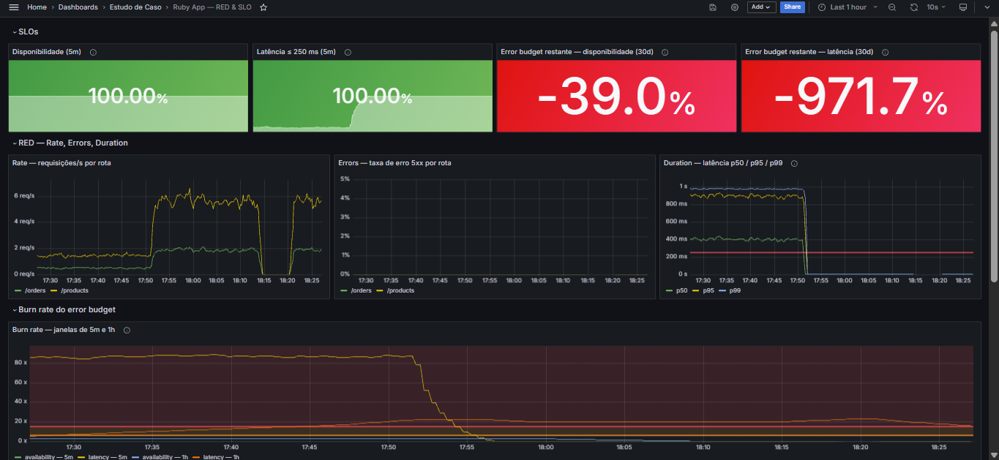
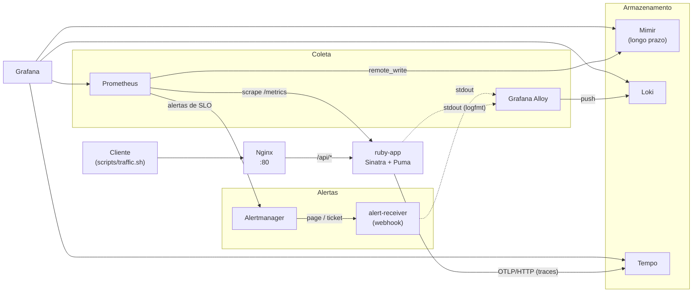
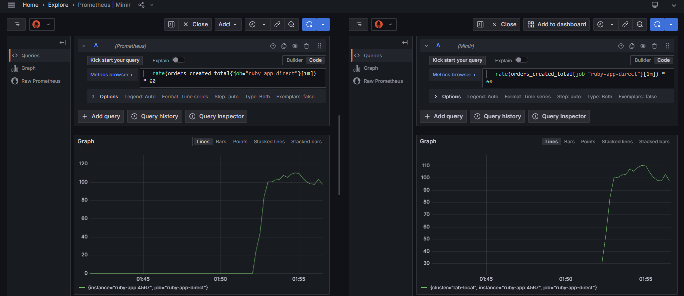
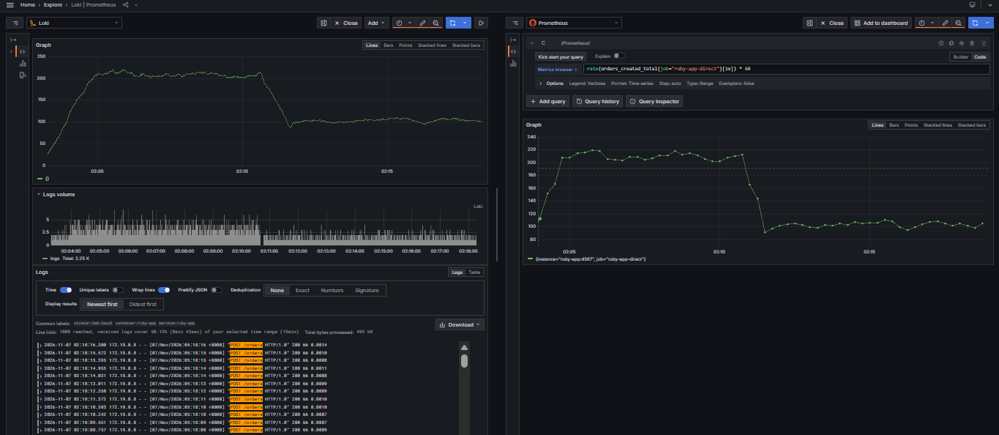
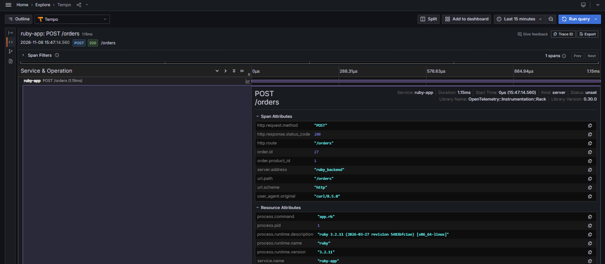
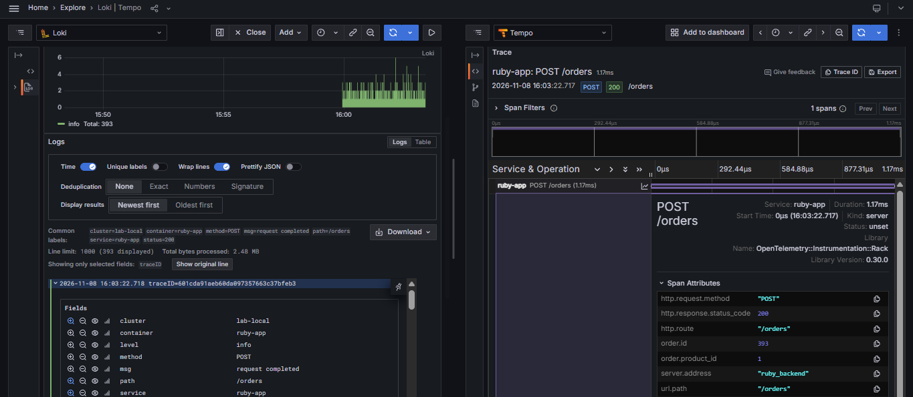
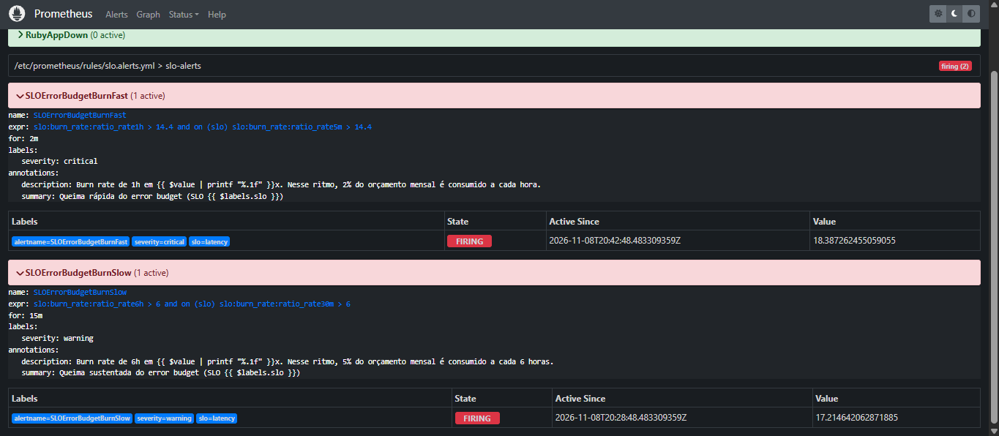
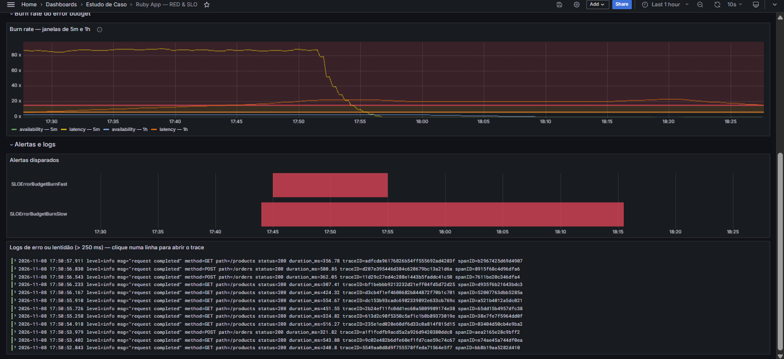

# Estudo de Caso de Observabilidade → SRE na prática

Uma aplicação Ruby legada instrumentada com os **três pilares da observabilidade**
(métricas, logs e traces correlacionados), **SLOs com alertas de burn rate**,
**Game Days** com injeção de falhas e **postmortem blameless** — tudo como código,
rodando com um comando.



---

## Sumário

- [Sobre o projeto](#sobre-o-projeto)
- [Arquitetura](#arquitetura)
- [Como executar](#como-executar)
- [Os três pilares](#os-três-pilares)
- [SRE na prática](#sre-na-prática)
- [Decisões técnicas](#decisões-técnicas)
- [Aprendizados](#aprendizados)
- [Limitações conhecidas](#limitações-conhecidas)
- [Roadmap](#roadmap)
- [Estrutura do repositório](#estrutura-do-repositório)

---

## Sobre o projeto

O projeto nasceu de um **desafio técnico**: instrumentar uma aplicação Ruby legada
(Sinatra atrás de um Nginx) **sem suporte a OpenTelemetry nem a Prometheus exporter**,
usando a stack Grafana, Prometheus, Mimir, Loki e Tempo. A primeira versão resolveu o
desafio dentro dessa restrição, com um endpoint `/metrics` montado manualmente.

A partir daí, o projeto evoluiu em três etapas, cada uma entregue em um Pull Request:

| Etapa | Entrega |
|---|---|
| **1. Estabilização** | Versões das imagens fixadas, correção do formato de métricas, remoção de `docker system prune` |
| **2. Três pilares** | `remote_write` para o Mimir, logs com Grafana Alloy, traces com OpenTelemetry e correlação log ↔ trace |
| **3. SRE** | Métricas RED, SLOs, alertas de burn rate em múltiplas janelas, Alertmanager, Game Days e postmortem |

---

## Arquitetura



| Componente | Versão | Papel |
|---|---|---|
| ruby-app | Ruby 3.2 · Sinatra 3 · Puma 6 | Aplicação instrumentada com `prometheus-client` e OpenTelemetry |
| Nginx | 1.27 | Proxy reverso (`/api/*` e `/metrics`) |
| Prometheus | 2.53.0 | Coleta de métricas, recording rules de SLO e avaliação de alertas |
| Mimir | 2.13.0 | Armazenamento de métricas de longo prazo (via `remote_write`) |
| Grafana Alloy | 1.4.2 | Coleta dos logs dos containers via Docker socket |
| Loki | 2.9.10 | Armazenamento e consulta de logs |
| Tempo | 2.6.0 | Armazenamento e consulta de traces (OTLP) |
| Alertmanager | 0.27.0 | Roteamento, agrupamento e inibição de alertas |
| Grafana | 11.2.0 | Visualização, com datasources e dashboards provisionados |

---

## Como executar

**Pré-requisitos:** Docker com Compose v2, `make` e ~4 GB de RAM livres.

```bash
git clone https://github.com/guilhermemleite/estudo-de-caso-observabilidade.git
cd estudo-de-caso-observabilidade
make up        # sobe a stack (build incluso)
make health    # aguarda e verifica os 9 componentes
make traffic   # gera tráfego por 10 minutos
```

| Serviço | Endereço |
|---|---|
| Grafana | http://localhost:3000 (`admin` / `admin`) → pasta **Estudo de Caso** |
| Prometheus | http://localhost:9090 |
| Alertmanager | http://localhost:9093 |
| Alloy | http://localhost:12345 |
| Aplicação | http://localhost/api/products |

Rode `make` para ver todos os comandos. Os principais:

| Comando | O que faz |
|---|---|
| `make up` / `make down` | Sobe / para a stack (os dados são mantidos) |
| `make health` | Verifica todos os componentes, com novas tentativas |
| `make traffic` / `make traffic-stop` | Inicia / para o gerador de tráfego |
| `make chaos-errors` | Injeta 5% de erros 5xx (`ERROR_RATE=0.05`) |
| `make chaos-latency` | Injeta 400 ms de latência (`LATENCY_MS=400`) |
| `make chaos-off` | Desliga a injeção de falhas |
| `make logs s=<serviço>` | Logs ao vivo de um serviço |

---

## Os três pilares

### Métricas

A aplicação expõe métricas **RED** com a gem `prometheus-client`:
`http_requests_total{method, route, status}` e o histograma
`http_request_duration_seconds`. O Prometheus coleta e replica tudo para o
Mimir via `remote_write`.



*Mesma consulta nos dois backends: o Mimir só tem dados a partir da ativação do
`remote_write` (sem backfill) e carrega o label `cluster` vindo de `external_labels`.*

### Logs

O Grafana Alloy descobre os containers do projeto pelo Docker socket e envia
stdout/stderr ao Loki, com os labels `service`, `container` e `cluster`.
A aplicação grava logs estruturados em **logfmt**, com `traceID` e `duration_ms`.



*Validação cruzada: pedidos por minuto contados a partir dos logs (esquerda) e
pelo contador do Prometheus (direita). Dois sinais independentes, a mesma curva.*

### Traces

A aplicação é instrumentada com o SDK do OpenTelemetry (Rack + Sinatra) e
exporta via OTLP/HTTP para o Tempo. Os spans carregam **atributos de negócio**
(`order.id`, `order.product_id`). `/health` e `/metrics` ficam fora dos traces.



### Correlação

Cada linha de log carrega o `traceID`. No Grafana, um *derived field* do Loki
transforma esse ID em link: **um clique leva do log ao trace**.



*O `order.id` do trace (393) coincide com o total de linhas de pedido no Loki
desde o restart da aplicação: o pipeline não perde nem duplica eventos.*

---

## SRE na prática

### SLOs

| SLO | SLI | Objetivo | Error budget |
|---|---|---|---|
| **Disponibilidade** | Requisições sem 5xx em `/products` e `/orders` | 99,5% | 0,5% |
| **Latência** | Requisições respondidas em ≤ 250 ms | 99% | 1% |

Os SLIs, o burn rate (janelas de 5m, 30m, 1h e 6h) e o orçamento restante são
calculados por **18 recording rules** em
[`monitoring/rules/slo.rules.yml`](monitoring/rules/slo.rules.yml).

### Alertas de burn rate em múltiplas janelas

Seguindo o *Site Reliability Workbook* do Google:

| Alerta | Condição | Significado | Rota |
|---|---|---|---|
| `SLOErrorBudgetBurnFast` | burn 1h **e** 5m > 14,4x | 2% do orçamento mensal em 1h | `page` |
| `SLOErrorBudgetBurnSlow` | burn 6h **e** 30m > 6x | 5% do orçamento mensal em 6h | `ticket` |
| `RubyAppDown` | target fora do ar por 1 min | serviço indisponível | `page` |
| `RubyAppNoTraffic` | sem requisições de negócio por 5 min | "silêncio não é saúde" | `ticket` |

A janela longa evita disparos por picos isolados; a curta faz o alerta resolver
poucos minutos após a correção. O Alertmanager roteia por severidade e **inibe**
o aviso quando o crítico do mesmo SLO está ativo.



### Dashboard RED & SLO

Provisionado como código em
[`monitoring/dashboards/ruby-app-red-slo.json`](monitoring/dashboards/ruby-app-red-slo.json):
SLOs, Rate/Errors/Duration por rota, burn rate com linhas de limiar, linha do
tempo dos alertas e logs de erro ou lentidão com link para o trace.



### Game Days

A aplicação tem um endpoint de injeção de falhas (`/admin/chaos`) que altera a
taxa de erro e a latência em tempo real. Foram conduzidos dois exercícios:

1. **Erros**: 5% de respostas 5xx → burn rate de disponibilidade em ~10x.
2. **Latência**: 400 ms (±50%) → burn rate de latência em ~88x, alertas
   crítico e de aviso disparados, roteados e resolvidos.

📄 **[Postmortem do Game Day de latência](docs/postmortems/2026-11-08-degradacao-latencia.md)**
— linha do tempo, MTTD, causa raiz, itens de ação e lições aprendidas.

---

## Decisões técnicas

| Decisão | Motivo |
|---|---|
| Versões fixadas em todas as imagens | `:latest` quebrou a stack (Loki 3.x incompatível com a configuração existente) |
| Loki 2.9.10 | Compatível com `boltdb-shipper` e schema v11. Migrar para TSDB/v13 é pré-requisito para o Loki 3 |
| Remoção de `docker system prune -f` | Apagava containers parados de **outros projetos** da máquina |
| Mimir single-tenant, replication factor 1 | Ambiente de um nó só; sem isso, o Grafana precisaria enviar `X-Scope-OrgID` |
| Label `route` com lista fechada de rotas | Evita explosão de cardinalidade: caminhos desconhecidos viram `unmatched` |
| `/health` e `/metrics` fora das métricas RED e dos traces | Scrapes e healthchecks inflavam o tráfego e poluíam os traces |
| SLIs calculados só com o job `ruby-app-direct` | O app é coletado direto e via Nginx; somar os dois dobraria os valores |
| Limiar de latência do SLO (250 ms) igual a um limite de balde | O SLI fica exato, sem a interpolação do `histogram_quantile` |
| Alloy com filtro por projeto Compose | Não coleta logs de outros containers da máquina |
| Receptor de webhook próprio no lugar de Slack/Telegram | Sem segredos no repositório; as notificações também chegam ao Loki |
| Datasources, dashboards e regras provisionados como código | Versionados, revisáveis em PR e reproduzíveis |

---

## Aprendizados

- **Coordinated omission**: o gerador de carga é sequencial. Com a latência
  injetada, o tráfego caiu de ~7 para ~1,9 req/s, o que diluiu o impacto nas
  janelas longas e atrasou a detecção. Usuários reais não desaceleram junto
  com o sistema.
- **Percentis de histograma são estimativas**: durante o Game Day, o p95
  calculado foi ~0,9 s, mas o real era ~0,58 s. O `histogram_quantile`
  interpola linearmente dentro do balde (0,5 s–1 s].
- **Error budget precisa de histórico**: o mesmo incidente consumiu ~6% do
  orçamento mensal de latência, mas o painel mostrou -1.013% porque a janela
  de 30 dias tinha só ~1h30 de dados.
- **Janelas curtas fazem o alerta resolver rápido**: o burn de 1h ficou acima
  de 20x por mais de 30 min após a correção, mas o crítico resolveu em ~4 min,
  porque exige também a janela de 5m.
- **Tamanho da janela do `rate()` é um trade-off**: janelas maiores suavizam o
  ruído, mas demoram mais para refletir mudanças.

---

## Limitações conhecidas

Ambiente de laboratório, com dívidas técnicas conscientes:

- **Segurança**: Grafana com `admin/admin`, `/admin/chaos` sem autenticação e
  API administrativa do Prometheus habilitada. Nada disso iria para produção.
- **Nginx não instrumentado**: o trace começa no app, não no proxy. O Nginx
  também usa HTTP/1.0 no upstream e não repassa o header `Host`.
- **Spans sem filhos**: o trace mostra o tempo total do handler, mas não as
  etapas internas.
- **Baldes do histograma**: falta resolução entre 0,5 s e 1 s (alternativa:
  native histograms).
- **Logs duplicados**: o access log do Puma convive com o log estruturado.
- **Imagem do app**: sem build multi-stage e sem `Gemfile.lock`.
- **Tempo**: metrics-generator desativado (sem service graph e span metrics).

Os itens de ação estão detalhados no
[postmortem](docs/postmortems/2026-11-08-degradacao-latencia.md#itens-de-ação).

---

## Roadmap

**Versão 2 — Kubernetes e automação:**

- [ ] Migrar para **k3s** com **Helm** (charts da stack LGTM e da aplicação)
- [ ] Infraestrutura com **Terraform**
- [ ] **GitHub Actions**: build da imagem, validação com `promtool` e `amtool`,
      subida da stack e `make health` como teste de integração
- [ ] Gerador de carga de ciclo aberto com **k6**
- [ ] **OpenTelemetry Collector** entre a aplicação e os backends
- [ ] Ativar o metrics-generator do Tempo (service graph e span metrics)
- [ ] Instrumentar o ingress para traces de ponta a ponta
- [ ] README em inglês

---

## Estrutura do repositório

```
.
├── Makefile                      # atalhos: make up, make health, make chaos-latency...
├── docker-compose.yml
├── ruby-app/                     # aplicação Sinatra instrumentada (Prometheus + OpenTelemetry)
├── nginx/                        # proxy reverso
├── monitoring/
│   ├── prometheus.yml
│   ├── rules/                    # recording rules de SLO e regras de alerta
│   ├── alertmanager.yml          # rotas page/ticket e inibição
│   ├── alert-receiver.py         # receptor de webhook (notificações → stdout → Loki)
│   ├── config.alloy              # coleta de logs dos containers
│   ├── mimir.yml · loki.yml · tempo.yml
│   ├── datasources.yml           # datasources do Grafana, com correlação log ↔ trace
│   ├── grafana-dashboards.yml    # provisionamento de dashboards
│   └── dashboards/               # dashboards como código
├── scripts/                      # tráfego, healthcheck e injeção de falhas
└── docs/
    ├── img/                      # evidências (prints)
    ├── dashboards/               # dashboard da primeira versão (histórico)
    └── postmortems/              # notas de incidente e postmortem
```

---

## Autor

**Guilherme Moreira Leite** — Observabilidade e SRE

[LinkedIn](https://www.linkedin.com/in/guilhermemleite/) ·
[GitHub](https://github.com/guilhermemleite)
